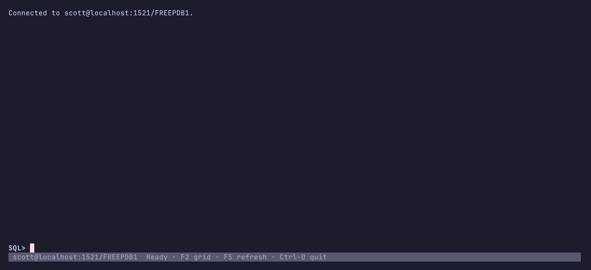
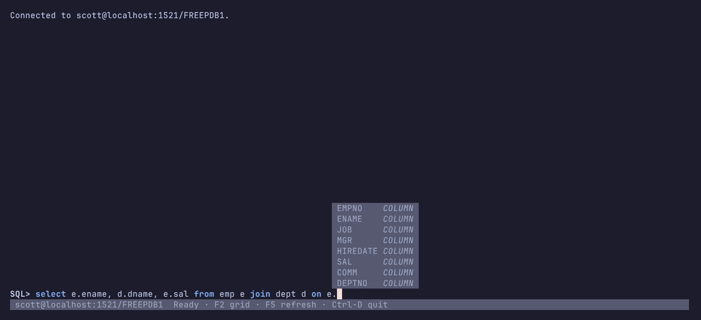

# oracli

A terminal client for Oracle Database that completes SQL like a code editor. In the spirit of SQLcl and SQL\*Plus, with a prompt that knows the grammar and your schema. Written in Rust on [ratatui](https://ratatui.rs), talking to Oracle through [oracle-rs](https://crates.io/crates/oracle-rs), so no Oracle Client libraries are needed.



## Completion that reads the statement

oracli parses the input with a tree-sitter grammar for Oracle SQL and PL/SQL on every keystroke, so the menu offers what fits where the cursor is, the way an editor's language server would:



- **As you type**: the menu follows each keystroke, filtered by the word under the cursor. Enter still runs the statement; Tab or ↓ picks a candidate.
- **Context-aware**: table names after `FROM` and `JOIN`, columns and keywords where an expression goes, keywords after a table alias. Only where the input does not parse yet does the menu fall back to everything.
- **Aliases resolved**: `e.` lists the columns of the table aliased `e` in any clause, including the select list once the `FROM` names the table.
- **Columns from the statement**: unqualified column candidates come from every table the statement references.
- **Schemas and synonyms**: `HR.` loads HR's tables on demand, and public synonyms such as `DUAL` complete and resolve to their target's columns.
- **Preview in place**: moving through the menu writes the candidate into the input; Esc puts back what you typed, and one completion is one undo step.
- **Never blocks typing**: candidates are computed on a background thread and dictionary metadata loads in the background after connecting.

## Features

- Highlighting by the same parse tree that drives completion
- Multi-line SQL and PL/SQL input with SQLcl's rules for when Enter runs the statement
- Emacs key bindings, undo, kill ring, file-backed history with Ctrl-R search and fish-style suggestions
- Full-screen result grid that fetches more rows as you scroll
- Ctrl-C cancels a running statement
- `NO_COLOR` support and a TOML config for colors and table layout

## Status

| Area                                                               |     | Notes                                                                                                                                                                                                                                        |
| ------------------------------------------------------------------ | --- | -------------------------------------------------------------------------------------------------------------------------------------------------------------------------------------------------------------------------------------------- |
| Connect: Easy Connect, `tnsnames.ora` alias, `$TWO_TASK`, `/nolog` | ✅  | An alias must resolve to a single TCP address                                                                                                                                                                                                |
| Password prompt                                                    | ✅  | On the command line only; `CONNECT` needs it inline ([#6](https://github.com/sei40kr/oracli/issues/6))                                                                                                                                       |
| Run SQL and PL/SQL with SQLcl's Enter rules                        | ✅  | Statements the grammar does not parse are not detected as finished ([#1](https://github.com/sei40kr/oracli/issues/1))                                                                                                                        |
| `CONNECT`, `DESC`, `EXIT` / `QUIT`                                 | ✅  |                                                                                                                                                                                                                                              |
| Result log and full-screen grid with paging                        | ✅  | Pages re-run the query with `OFFSET` / `FETCH`                                                                                                                                                                                               |
| Ctrl-C cancels a running statement                                 | ✅  | Reconnects; uncommitted work is lost                                                                                                                                                                                                         |
| Syntax highlighting                                                | ✅  |                                                                                                                                                                                                                                              |
| Completion: keywords, tables, columns, aliases, schemas, synonyms  | ✅  | Columns are not scoped to the query block at the cursor ([#2](https://github.com/sei40kr/oracli/issues/2)), synonym gaps ([#3](https://github.com/sei40kr/oracli/issues/3)), quoted names ([#7](https://github.com/sei40kr/oracli/issues/7)) |
| Emacs keys, undo, kill ring, history with search and suggestions   | ✅  |                                                                                                                                                                                                                                              |
| Config file and `NO_COLOR`                                         | ✅  | Colors and table layout only; no connection settings                                                                                                                                                                                         |
| Warning on exit with uncommitted DML                               | ✅  |                                                                                                                                                                                                                                              |
| `ORA-` error codes                                                 | ❌  | Lost by oracle-rs                                                                                                                                                                                                                            |
| Vi key bindings, key remapping                                     | ❌  |                                                                                                                                                                                                                                              |
| Saved connections                                                  | ❌  |                                                                                                                                                                                                                                              |
| Schema browser                                                     | ❌  |                                                                                                                                                                                                                                              |
| Export, `EXPLAIN PLAN`                                             | ❌  |                                                                                                                                                                                                                                              |
| SQLcl `SET`, `@script`, `SPOOL`                                    | ❌  |                                                                                                                                                                                                                                              |
| Multiple result tabs                                               | ❌  |                                                                                                                                                                                                                                              |

## Install

With Nix:

```
nix run github:sei40kr/oracli -- scott/tiger@localhost:1521/FREEPDB1
nix profile install github:sei40kr/oracli
```

With Cargo (needs a C compiler and CMake):

```
cargo install --git https://github.com/sei40kr/oracli oracli
```

## Usage

```
oracli user/pass@host:port/service
oracli user@host:port/service     # prompts for the password
oracli user                       # connect string from $TWO_TASK
oracli /nolog                     # start unconnected (also the default)
```

The connect identifier is an Easy Connect string or a `tnsnames.ora` alias. The file is found as SQL\*Plus finds it: `$TNS_ADMIN`, then `$ORACLE_HOME/network/admin`. An alias must resolve to a single TCP address with a `SERVICE_NAME` or `SID`; failover and load-balanced address lists are reported as errors.

Inside the prompt:

| Command                               |                                                                                                              |
| ------------------------------------- | ------------------------------------------------------------------------------------------------------------ |
| `CONNECT user/pass@host:port/service` | Connect or reconnect; the password must be inline for now ([#6](https://github.com/sei40kr/oracli/issues/6)) |
| `DESC [schema.]object`                | Describe a table or view                                                                                     |
| `EXIT`, `QUIT`                        | Leave; warns once if DML is uncommitted                                                                      |

### Running statements

Enter runs the input when it ends with `;`, or with a line holding only `/`. Otherwise it inserts a newline. PL/SQL blocks end with their own `end;`, so they need the `/` line:

```
SQL> begin
       dbms_output.put_line('hi');
     end;
     /
```

Alt-Enter runs the input as it is. One input runs one statement.

### Keys

| Key                                   | Action                                                  |
| ------------------------------------- | ------------------------------------------------------- |
| Enter / Alt-Enter                     | Run (see above) / run now                               |
| Ctrl-O                                | Insert a newline                                        |
| Tab, Shift-Tab                        | Complete, next / previous candidate                     |
| Esc                                   | Close the completion menu and restore what was typed    |
| Up, Down                              | Previous / next line, then history                      |
| Ctrl-R                                | Search history                                          |
| → or Ctrl-E at the end                | Accept the history suggestion                           |
| Ctrl-_ / Alt-_                        | Undo / redo                                             |
| Ctrl-K, Ctrl-U, Ctrl-W, Alt-D, Ctrl-Y | Kill and yank                                           |
| PageUp, PageDown                      | Scroll the result log                                   |
| F2                                    | Open the latest result in the grid (q or Esc closes it) |
| F5                                    | Reload the current schema for completion                |
| Ctrl-C                                | Cancel the running statement, or clear the input        |
| Ctrl-D                                | Quit on an empty input                                  |

History is saved to `$XDG_DATA_HOME/oracli/history` (`~/.local/share/oracli/history`).

### Configuration

oracli reads `$XDG_CONFIG_HOME/oracli/config.toml` (`~/.config/oracli/config.toml`) if it exists. Every key is optional:

```toml
log_rows = 20         # rows of each result shown in the log; F2 shows the rest
max_cell_width = 40   # widest a column gets in the log and the grid

[theme]
keyword = { fg = "blue", add_modifier = "BOLD" }
comment = { fg = "dark-gray", add_modifier = "ITALIC" }
status = { fg = "white", bg = "#303030" }
```

A style in `[theme]` replaces the built-in one whole. It takes `fg` and `bg` (a color name, an index such as `"42"`, or `"#rrggbb"`) and `add_modifier` and `sub_modifier` (`"BOLD | ITALIC"`; also `DIM`, `UNDERLINED`, `REVERSED`, `CROSSED_OUT`). Styles: `keyword`, `string`, `number`, `quoted_identifier`, `comment`, `prompt`, `suggestion`, `menu`, `menu_selected`, `menu_meta`, `warning`, `error`, `header`, `muted`, `grid_selected`, `status`, `status_dirty`, `status_busy`. The theme replaces the colors `NO_COLOR` would turn off, so styles set here apply even then.

## Limitations

oracle-rs 0.1.7 has a few gaps that oracli works around:

- Results page by re-running the query with `OFFSET ... FETCH NEXT`, so pages can shift without a stable `ORDER BY`.
- A SQL error closes the session. oracli reconnects, but uncommitted work is lost and the `ORA-` code is not shown.
- Ctrl-C drops and reopens the connection, which also loses uncommitted work.

Statements the grammar does not know yet, such as `ALTER`, `GRANT` and `CREATE PACKAGE`, are not recognized as finished ([#1](https://github.com/sei40kr/oracli/issues/1)). Known gaps are tracked in [issues](https://github.com/sei40kr/oracli/issues).

## Development

The workspace holds two crates:

| Crate                                                  |                                                   |
| ------------------------------------------------------ | ------------------------------------------------- |
| [`crates/oracli`](crates/oracli)                       | The application                                   |
| [`crates/tree-sitter-plsql`](crates/tree-sitter-plsql) | The tree-sitter grammar for Oracle SQL and PL/SQL |

The input line comes from [ratatui-ptk](https://github.com/sei40kr/ratatui-ptk), a prompt_toolkit-like input library for ratatui.

```
nix develop                  # or direnv; Rust, tree-sitter CLI, cargo-insta, mold, sccache
cargo test                   # unit and snapshot tests
nix flake check              # clippy, tests, formatting
```

Integration tests run against Oracle Database Free in a container:

```
docker compose up -d --wait  # scott/tiger@localhost:1521/FREEPDB1
cargo test -- --ignored
docker compose down
```

The demo above is recorded with [VHS](https://github.com/charmbracelet/vhs) against the compose database:

```
docker compose exec -T oracle sqlplus -s scott/tiger@FREEPDB1 < docs/demo/schema.sql
cargo build --release -p oracli
vhs docs/demo/demo.tape
```

After editing `crates/tree-sitter-plsql/grammar.js`, regenerate and test the parser:

```
cd crates/tree-sitter-plsql
tree-sitter generate
tree-sitter test
```

## License

[MIT](LICENSE)
